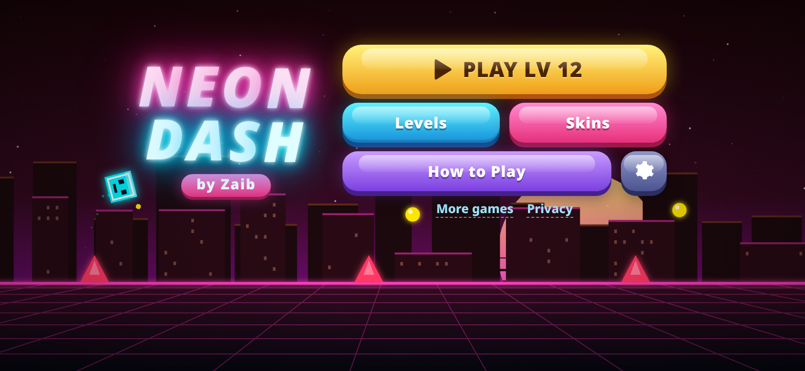
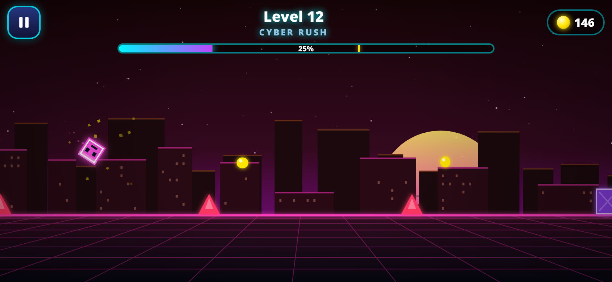

# Neon Dash ⚡

**A one-tap neon rhythm runner for mobile and desktop browsers. Game by Zaib.**

▶ **Play:** https://zaibgames.com/neon-dash/

Your glowing cube dashes forward by itself. Tap to jump over pink spikes and purple blocks, grab coins in the air and reach the finish gate. There are 200 levels, and each one is a bit faster and denser than the last.

## Features
- **200 levels, all checked by a solver:** each level is generated from a fixed seed, so it is the same every attempt. It is only accepted if a frame-exact solver can beat it with fair timing windows.
- **44 neon skins** you buy with coins (coins from the air, plus +5 for each level you clear).
- **Level select** with unlocks, best-percent per level and a best-run marker on the progress bar.
- **Juice:** glow, trails, particle bursts, screen shake, a synthwave city with parallax, a sun and a moving grid floor. The theme color changes per track.
- **Sound:** WebAudio sound effects and generated synthwave music (10 tracks, one key/chord loop per song).
- **Screens:** title with a live demo run, how-to-play, settings (sound, music, vibration, reset progress), pause with a resume countdown, and win/crash results.
- **Mobile-first:** the canvas fills the screen with no scrolling or zooming, safe-area aware. It works in portrait and landscape (landscape shows further ahead). Holding the button re-jumps when you land, a short input buffer catches early taps, and the game pauses when you switch tabs.
- **Tech:** one self-contained HTML file. Fixed 60 Hz physics with interpolated rendering, so it plays the same on 60/120/144 Hz screens. Lower effects are used automatically on slow devices. Progress is saved in localStorage. No ads.

## Controls
| Action | Touch / mouse | Keyboard |
|---|---|---|
| Jump (hold to keep jumping) | Tap / hold | Space, ↑, W |
| Pause | ⏸ | Esc / P |
| Restart | Pause → Restart | R |

## Credits
Game, code, music and sound by **Zaib**.
